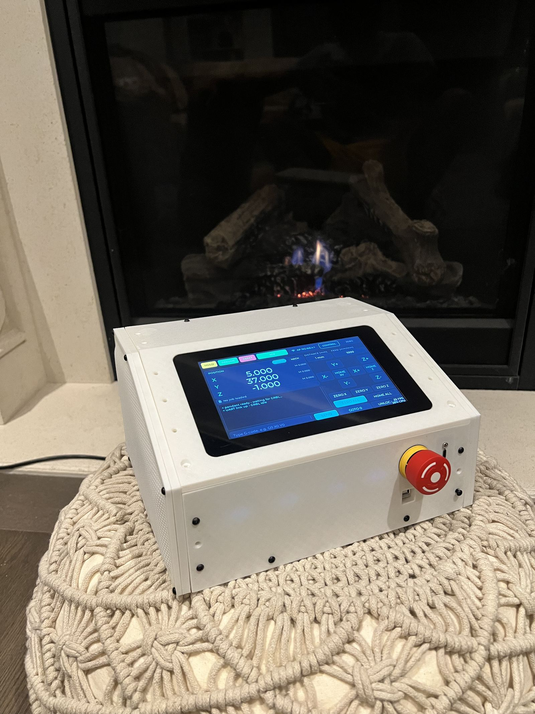
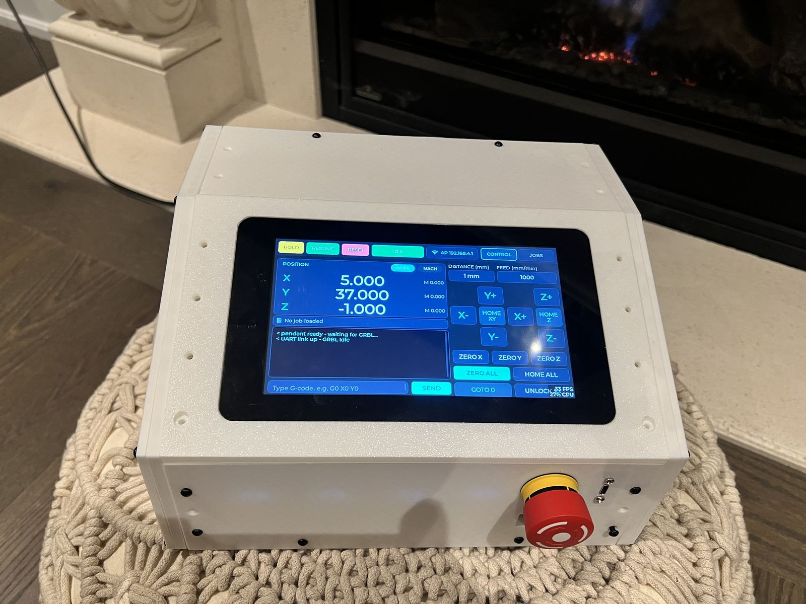
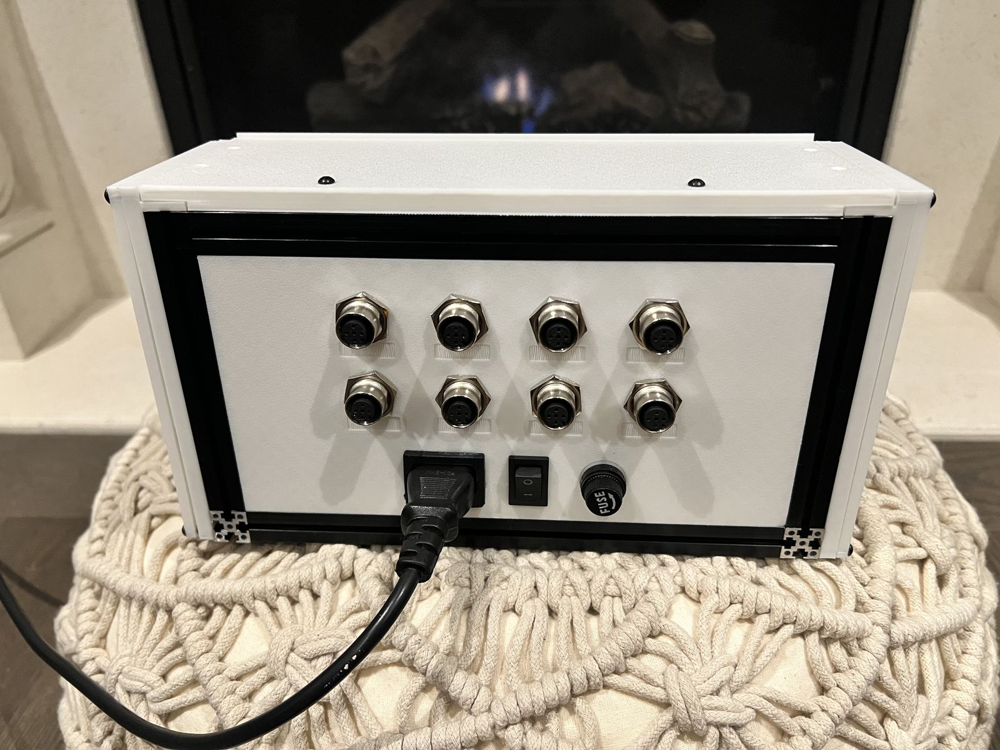
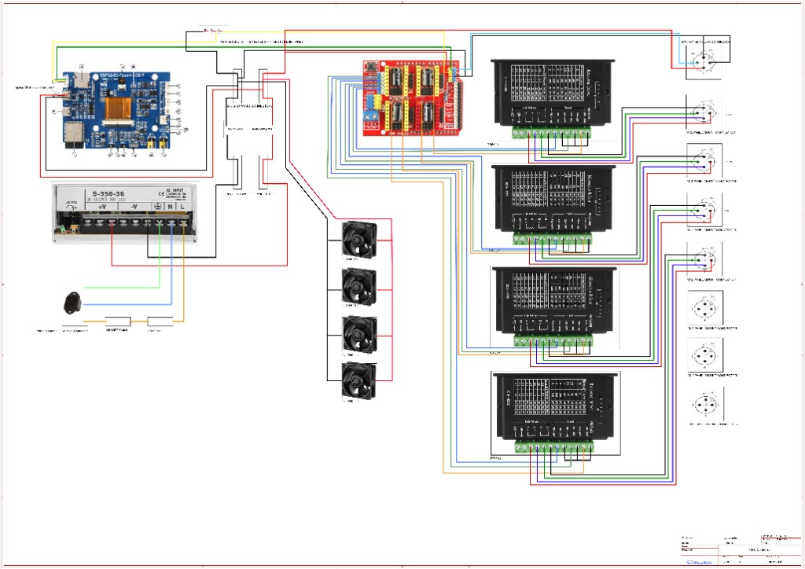

# CNC Controller Box

A self-contained **controller enclosure** for a GRBL CNC router: mains in, motion out, a 7" touchscreen on the lid.

The mill itself is not in this repository. This project is the **box** — a **1515 extrusion subframe** with **PETG printed skins**, 36 V power, four external stepper drivers, panel M12 I/O, an Arduino Uno + CNC shield running GRBL 1.1, and a Waveshare ESP32-S3 7" pendant.

|           |                                                                                      |
| --------- | ------------------------------------------------------------------------------------ |
| Structure | 8 × 200 mm **1515** extrusion, PETG skins / mounts, heat-gun–molded fan grills       |
| Motion    | Arduino Uno clone + CNC Shield v3 → 4 × TB6600 (X/Y/Z/A)                             |
| Power     | Generic **36 V 350 W** PSU → Wago bus; **LM2596** 36 V→5 V; NC e-stop on motor power |
| HMI       | Waveshare **ESP32-S3-Touch-LCD-7** (LVGL) over UART to GRBL                          |
| Panel I/O | 8 × M12: 4 motors, 3 endstops, 1 probe / 5 V utility                                 |

**Build this:** [instructions](instructions.md) · **Wiring & mechanics:** [hardware](docs.md/hardware.md) · **Firmware:** [software](docs.md/software.md) · **CAD:** [cad/](cad/)

The diagram is the as-drawn schematic. Two nets are **as-built but not drawn** — each driver takes its own 36 V pair from the Wago bus, and three M12s go to the CNC-shield endstop headers. Details in [hardware](docs.md/hardware.md).

---

## Purpose

Hobby GRBL setups usually look like a Uno, a shield, and a nest of Dupont wires next to a laptop. This box treats that stack as panel hardware: fused mains, a real 36 V rail, external drivers, bulkhead connectors, and a pendant that does not depend on a PC.

The 1515 cage is the structure; PETG is the cover. Fan grills are thermoformed over a printed mold with a heat gun instead of being milled — process at the end of [instructions](instructions.md). Firmware in this repo makes the same box usable from the screen, a browser on the LAN, or a USB G-code sender.

Submitted for the **[Blueprint](https://blueprint.am)** Summer Build Contest (controller-box BOM target **under US$250**).

---

## Bill of materials

Controller box only. Mill, NEMA motors, and machine-side limit switches are out of scope. Contest target **under US$250**.

IEC inlet, fuses, Wagos, hookup wire, heat-shrink, and 1515 T-nuts are **negligible** (shop leftovers / pennies) and are not line-items.

### Purchased

| Part                                     | Qty | Unit   | Source                     | Subtotal    |
| ---------------------------------------- | --- | ------ | -------------------------- | ----------- |
| Arduino Uno R3 clone (CH340, ATmega328P) | 1   | $8.00  | eBay                       | $8.00       |
| Generic TB6600 stepper driver            | 4   | $5.00  | eBay                       | $20.00      |
| 4010 36 V cooling fan                    | 4   | $1.50  | eBay                       | $6.00       |
| LM2596 DC-DC buck (36 V → 5 V)           | 1   | $4.50  | eBay                       | $4.50       |
| Generic 36 V 350 W (10 A) PSU            | 1   | $28.00 | eBay                       | $28.00      |
| CNC Shield v3                            | 1   | $6.00  | AliExpress / Amazon / eBay | $6.00       |
| BSS138 4-ch UART level shifter           | 1   | $3.00  | AliExpress / Amazon / eBay | $3.00       |
| Waveshare ESP32-S3-Touch-LCD-7           | 1   | $85.00 | AliExpress / Amazon / eBay | $85.00      |
| 1515 extrusion, 200 mm                   | 8   | $2.50  | AliExpress / Amazon / eBay | $20.00      |
| M12 4-pin aviation / bulkhead            | 8   | $3.50  | AliExpress / Amazon / eBay | $28.00      |
| M3 screw and nut assortment              | 50  | $0.05  | AliExpress / Amazon / eBay | $2.50       |
| NC emergency-stop push button            | 1   | $7.00  | eBay                       | $7.00       |
| **Purchased subtotal**                   |     |        |                            | **$218.00** |

### PETG prints (filament)

| Part                           | Qty | Unit  | Notes                                              | Subtotal   |
| ------------------------------ | --- | ----- | -------------------------------------------------- | ---------- |
| Base plate                     | 1   | $4.00 | 40% infill, 0.4 mm layer; PSU / frame, open bottom | $4.00      |
| X / Y / Z / A driver mounts    | 4   | $1.50 | 20% infill, 0.2 mm; TB6600 to 1515                 | $6.00      |
| Fan grill (formed)             | 4   | $0.80 | 100% infill, 0.2 mm; mold + heat gun ([STEP](cad/Fan_Grill_Parts.step)) | $3.20      |
| Motion-controller mount (Uno)  | 1   | $2.00 | 30% infill, 0.2 mm, 4 perimeters                   | $2.00      |
| CNC-shield mount               | 1   | $2.00 | Wire-routing channels                              | $2.00      |
| HMI / touch-screen bezel mount | 1   | $2.00 | Flush face, cable relief                           | $2.00      |
| UART level-shifter mount       | 1   | $2.00 | M3 to chassis                                      | $2.00      |
| **Print subtotal**             |     |       |                                                    | **$21.20** |

|                          |             |
| ------------------------ | ----------- |
| **Controller-box total** | **$239.20** |
| Contest ceiling          | $250.00     |
| Headroom                 | $10.80      |

---

## Safety

This is machine-control hardware. The panel **NC e-stop** is meant to cut **motor 36 V** independently of the screen. The pendant **Stop** button is only a GRBL soft-reset (Ctrl-X): it halts motion; it does not replace the e-stop.

---

## Credits

- **Ian Kuula Ross** — supervisor, University of Waterloo SMART LAB
- **[Tejas Chopra](https://www.linkedin.com/in/tejas-chopra)** — hardware advisor; chemical engineering student, McMaster University
- **[Daud Khalid](https://www.linkedin.com/in/daudk3)** — software advisor; computer science student, Wilfrid Laurier University
- **[Uncle Jessy](https://www.youtube.com/@UncleJessy)** — [heat-gun mesh thermoforming](https://www.youtube.com/watch?v=TsG89NgZJO8) tutorial used for the fan grills

This project was made possible by collaboration and support from the **University of Waterloo SMART LAB**. Credit to **Professor Hamed Shahsavan**.

Submitted for the **[Blueprint.am](https://blueprint.am)** hardware hackathon — credit to their platform.

Firmware and prototype: **Haroon Khalid**.

---

## License

[MIT](LICENSE)