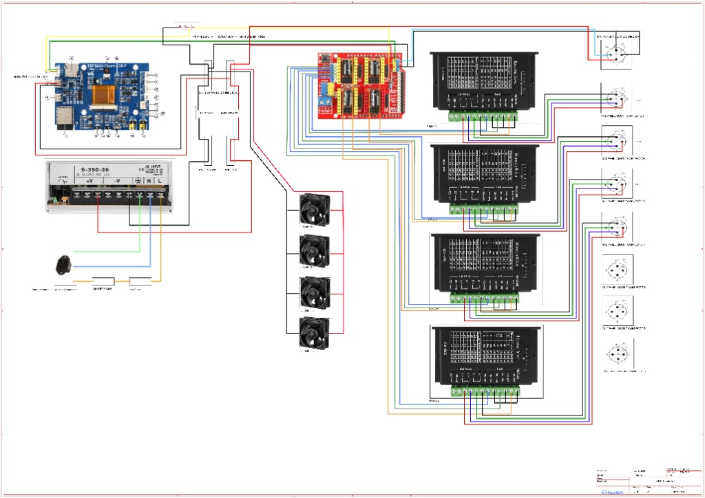

# Hardware

Electrical and mechanical design of the controller box. Firmware: [software.md](software.md). Build order: [instructions.md](../instructions.md). STEP assemblies: [cad/](../cad/).

## What this box is

A **panelized GRBL controller**: mains in, four high-current stepper channels out, endstops and a probe on bulkheads, logic and HMI inside a ventilated enclosure.

The CNC shield is **not** fitted with mini drivers. It is a **5 V signal breakout**. Motion current lives on four external TB6600-class drivers on a 36 V bus. That split is the point of the design — keep noisy motor current off the Uno, keep STEP/DIR/ENA as logic, and make every machine cable a panel M12.

## System diagram



### Read this diagram as as-built, not as-drawn

Two connections exist on the machine and are **missing from the graphic**:

1. **36 V to each stepper driver.** The S-350-36 feeds Wago +V / −V blocks. **Each of the four drivers gets its own pair** from those 5-port Wagos into the driver’s high-voltage terminals. Do not star the motor PSU only to the fans.
2. **Three M12s to endstops.** The graphic leaves three circular connectors floating. On the box they go to the **CNC shield endstop outputs, one axis each (X, Y, Z)**.

The fourth special M12 (not a motor) is **half 5 V / GND, half probe** — a utility / probe port, not a fourth endstop.

## Power

| Stage | As-built |
|---|---|
| Mains | IEC C14 inlet, rocker switch, dual AC fuses, earth to PSU chassis (negligible BOM) |
| PSU | Generic **36 V 350 W / 10 A** switching supply |
| 36 V distribution | Wago lever blocks. Red = +V, black = −V |
| E-stop | Panel **NC** mushroom — opens **driver 36 V**, not the ESP32 |
| Drivers | Four independent 36 V pairs, one per TB6600 (X, Y, Z, A) |
| Fans | Four **4010 36 V** blowers in parallel on the 36 V bus |
| Logic 5 V | **LM2596 buck**, 36 V → 5 V, for Uno / shield / utility M12 5 V |

Keep **motor 36 V return** and **logic GND** common at one star (PSU −V / Wago −V / Uno GND). Without a common ground, STEP/DIR looks like noise and the Uno will brown out when the motors move.

The touchscreen Stop is a GRBL soft-reset. The **NC e-stop** is the power cut.

## Motion path

```
ESP32-S3 pendant  --UART 3.3 V-->  level shifter  --5 V-->  Uno RX/TX (GRBL)
                                                          |
                                                          CNC Shield v3  (PUL / DIR / EN per axis)
                                                          |
                                                          4 × TB6600-class  --phases-->  4 × motor M12
```

- **GRBL 1.1** on the Uno is the motion controller. The pendant is a serial master (jog, streamer, status `?`), not a replacement for GRBL.
- Shield axis headers → driver **PUL / DIR / ENA** (low-voltage inputs). Colour harness on the diagram is the signal side only.
- Driver **A+ A− B+ B−** → one 4-pin M12 per motor.

Four drivers (**X, Y, Z, A**) vs three endstop M12s: **A has no dedicated limit bulkhead**. Homing in firmware/UI is XYZ (`$H`, Home XY / Home Z). Do not assume a fourth limit input on the panel.

## M12 map (8 ports)

| Role | Count | Wiring |
|---|---:|---|
| Stepper motors | 4 | Driver A+/A−/B+/B− |
| Endstops | 3 | CNC shield X, Y, Z endstop headers |
| Probe / utility | 1 | 5 V, GND, probe |

Rear layout (M12 grid, IEC, switch, fuse) is in the [overview](../README.md) and [instructions](../instructions.md). Role of each jack is the table above — there is no silkscreen on the panel.

## Pendant ↔ GRBL (UART)

The ESP32-S3 is **3.3 V and not 5 V-tolerant**. GRBL on the Uno uses pins **0 (RX) / 1 (TX)** at 115200 baud.

Use UART1 on the Waveshare **P1 header**: `GPIO43` TX, `GPIO44` RX. Set the board **UART selection switch to the header** (not the onboard USB-serial).

Bidirectional BSS138-class shifter, common ground:

```
 ESP32-S3 (P1)                 shifter                 Arduino Uno
   GPIO43 TX ──── LV1 <────> HV1 ────► RX (pin 0)
   GPIO44 RX ◄──── LV2 <────> HV2 ────  TX (pin 1)
   3V3 ────────── LV
                   HV ──────────────────  5V
   GND ────────── GND ──────────────────  GND
```

The Uno USB port and pins 0/1 are the **same UART**. Disconnect the pendant TX/RX before flashing GRBL from a PC.

The Waveshare board also has a **CH343 “UART” USB-C** and a **native USB** port. Native USB is the pendant CDC (flash + optional PC G-code feed). Details in [software.md](software.md).

## Mechanical

The structure is a **1515 aluminum extrusion subframe** (eight **200 mm** lengths). **PETG printed skins and mounts** cover that frame (base plate, driver mounts, HMI bezel, Uno / shield / shifter plates) so the box is rigid without a fully machined housing.

- Lid / front: 7" capacitive panel in a PETG bezel
- Rear / side: IEC, switch, fuse holders, eight M12 bulkheads
- Interior: PSU, Wagos, four drivers, four fans, Uno + shield, pendant, shifter — tied to the 1515 cage
- **Fan grills:** PETG mesh, printed flat and formed over a mold with a heat gun. Not CNC-cut and not a heated press. Mold: [`cad/Fan_Grill_Parts.step`](../cad/Fan_Grill_Parts.step). Process and credited tutorial: [instructions, step 9](../instructions.md#9-thermoform-the-fan-grills).

Full assemblies: [`cad/Extrusions.step`](../cad/Extrusions.step), [`cad/Hardware.step`](../cad/Hardware.step), [`cad/Electronics.step`](../cad/Electronics.step). Photos and CAD stills for the build live in `docs.md/images/`.

## Design choices

- **1515 cage + PETG skins:** extrusion carries load and fastener points; prints are covers and ducting, cheap to iterate.
- **Heat-gun molded grills:** one mold, no mill time for a vent pattern.
- **External drivers + 36 V**, not Pololus on the shield: current and heat stay on the driver bricks; the Uno stays a 5 V computer.
- **Wago 36 V bus** instead of daisy-chained driver screws: each driver is removable without breaking the rail.
- **M12 bulkheads** instead of flying leads: the box unplugs from the mill like a machine, not a breadboard.
- **GRBL stays on the Uno**: the ESP32 is HMI, job store, and USB/WiFi front end. Motion timing is not on WiFi.
- **Fans on 36 V**: they share the motor PSU, so they run whenever the bus is live.

## Safety (hardware)

- Fuse the **AC** side as drawn (two fuses on L/N as in the schematic).
- Earth the PSU chassis to the inlet earth.
- Do not probe 36 V with a logic probe meant for 5 V.
- Keep motor phase cables away from the UART pair.
